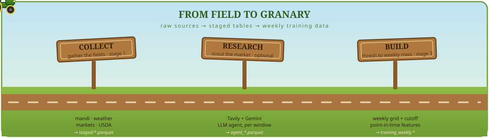
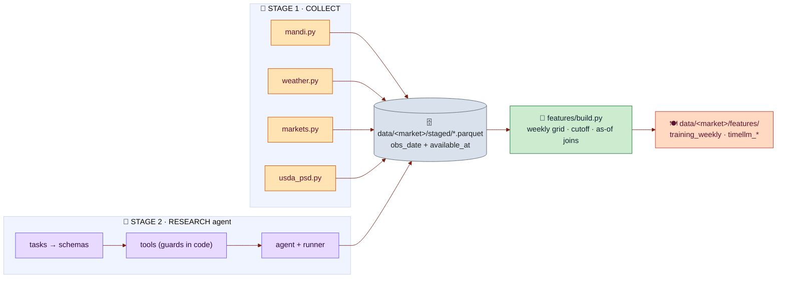
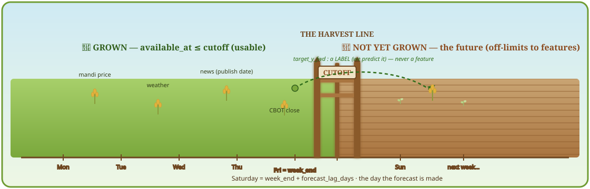
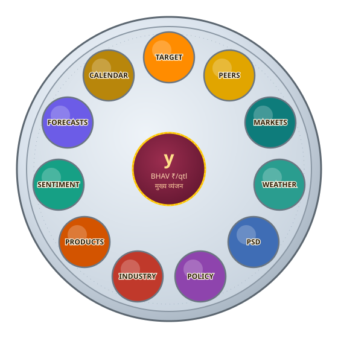

<div align="center">


<br/>


*Build the **training & test data** for a model that forecasts the **weekly soybean `bhav`** at an Indian mandi.*
*इंदौर से शुरू — किसी भी मंडी तक | starts at Indore, retargets to any mandi by changing one config.*

</div>

---

## 🪔 What is this?

This project is a **data kitchen**, not a model. It gathers raw ingredients from across the soybean
world — mandi prices, weather, global futures, USDA balance sheets, and an LLM that reads Hindi &
English market reports — cleans each into a tidy table, and plates up **one row per week** of
*point-in-time-safe* features plus the forward price labels. Hand the output to any forecaster
(tree, linear, or a Time-LLM / TimesFM style model) and it is ready to train.

> **Point-in-time safe** = every feature for a given week uses *only* information that was actually
> knowable by that week's forecast moment. No peeking at the future. (More on this `Lakshman Rekha`
> below. 👇)

---

## 🚂 The Data Express — three stations

Everything in the code is one of three stages. Picture the data riding a train from raw APIs to a
training table:

<div align="center">

</div>

| 🚉 Station | Code | What it does | Writes |
|---|---|---|---|
| **1 · COLLECT** | `src/soyfc/collectors/*.py` | Fetch structured sources → clean → tag `available_at` | `…/staged/<source>.parquet` |
| **2 · RESEARCH** *(optional)* | `src/soyfc/agent/*.py` | One LangChain agent per topic reads the web (Tavily + Gemini) | `…/staged/agent_*.parquet` |
| **3 · BUILD** | `src/soyfc/features/build.py` | Weekly grid + cutoff → point-in-time features + labels | `…/features/training_weekly.*` |

The conductor is the CLI — `python -m soyfc <command>` ([`__main__.py`](src/soyfc/__main__.py)).

---

## 🛕 Architecture at a glance



The glue — `config.py` (settings + secrets) and `store.py` (the `read / upsert` I/O layer, and the
**two-date rule**) — is used by every stage.

---

## ⚔️ The Lakshman Rekha — why there is no look-ahead

This is the heart of the whole project. Every staged row carries **two dates**:

- `obs_date` — the day the value *describes* (a mandi trading day, an article's subject day).
- `available_at` — the earliest day the value *could be known* (trading day + 1, an article's publish date).

Each week draws a line — `cutoff = week_end + forecast_lag_days` (Saturday). A feature may use **only**
rows with `available_at ≤ cutoff`. Cross that line and the future leaks into training. So we treat it
like a **लक्ष्मण रेखा**: features stay strictly on the knowable side; the forward price only ever
appears as a **label** we predict, never as an input.

<div align="center">

</div>

> 🔒 The guarantee is enforced by a test — [`test_no_lookahead`](src/soyfc/features/test_features.py):
> delete any data knowable only *after* a week's cutoff, rebuild, and that week's features must not change.

---

## 🍽️ The Feature Thali

`build.py` serves eleven **feature families** around the main dish — the target price `y`. Each katori
is one group function; every column it produces is recorded in the data dictionary.

<div align="center">

</div>

| 🥣 Katori | Group | Source table | A taste of the columns |
|---|---|---|---|
| 🟠 **TARGET** | `target` | `mandi_daily` | `y`, `y_lag1..4`, `y_ma4/13`, `ret_1w`, `arrivals_wk` |
| 🟡 **PEERS** | `peers` | `mandi_daily` | `peer_<mkt>_spread`, `peer_avg_spread` |
| 🟦 **MARKETS** | `markets` | `markets_daily` | `mkt_cbot_soybean`, `cbot_soy_rs_qtl`, `mkt_usdinr` |
| 🟢 **WEATHER** | `weather` | `weather_daily` | season rain, dry-spell, heat days, harvest rain |
| 🔵 **PSD** | `psd` | `psd_annual` | `psd_soybean_world_stocks_to_use`, ending stocks |
| 🟣 **POLICY** | `policy` | `seed_events.csv` + `agent_policy_events` | MSP, import duty, futures ban, tariff value |
| 🔴 **INDUSTRY** | `industry` | `agent_industry_stats` | `ind_sopa_crop_estimate_lt`, `ind_state_soy_*` |
| 🟧 **PRODUCTS** | `products` | `agent_product_prices` | `px_*_local`, `crush_gpm_rs_qtl`, `crush_margin_rs_qtl` |
| 🟩 **SENTIMENT** | `sentiment` | `agent_news_sentiment` | relevance-weighted news sentiment, by topic |
| 🟪 **FORECASTS** | `forecasts` | `agent_price_forecasts` | third-party price outlooks (direction / range) |
| 🟫 **CALENDAR** | `calendar` | derived | month / week-of-year seasonality, holidays |

📖 Full definitions — unit, source, availability rule — in [`docs/DATA_DICTIONARY.md`](docs/DATA_DICTIONARY.md).

---

## 🌶️ Quickstart

**1. Create a kernel and install the masala (dependencies):**

```bash
python -m venv .venv
```

```bash
.venv\Scripts\activate          # Windows   (use: source .venv/bin/activate on macOS/Linux)
```

```bash
pip install -r requirements.txt
```

**2. Add your API keys** (only the research agent needs them — collectors and `build` do not):

```bash
copy .env.example .env          # then edit: TAVILY_API_KEY, GOOGLE_API_KEY, DATA_GOV_IN_API_KEY
```

**3. Run the pipeline:**

```bash
python -m soyfc status          # what's staged so far
```

```bash
python -m soyfc collect weather # run one keyless collector
```

```bash
python -m soyfc build           # build the weekly training files
```

```bash
python -m soyfc agent --dry-run # show the agent's plan — no API calls, no cost
```

```bash
python -m soyfc run-all         # the full weekly job: collect + agent update + build
```

🪕 Prefer to watch it cell by cell? Open [`run_pipeline.ipynb`](run_pipeline.ipynb) — it walks every
stage and drops in a synthetic mandi series so `build` produces output even before you wire up live prices.

---

## 🗺️ Repo map

```
soyabean_price_forecast/
├── config/settings.yaml        # 🎛️  the one place you tune the target mandi, horizons, sources
├── src/soyfc/
│   ├── __main__.py             # 🚉  the CLI (collect | agent | build | status | run-all)
│   ├── config.py               # ⚙️  Settings + secrets (.env)  ·  per-market work_dir
│   ├── store.py                # 🗄️  read / upsert I/O  ·  the obs_date + available_at rule
│   ├── collectors/             # 🌾  mandi · weather · markets · usda_psd  (+ shared http.py)
│   ├── agent/                  # 🔎  tasks → schemas → tools → agent → runner
│   └── features/build.py       # 🍳  THE HEART: weekly grid, cutoff, one fn per feature family
├── docs/
│   ├── CODE_GUIDE.md           # 🧭  read-the-code onboarding (start here as a dev)
│   └── DATA_DICTIONARY.md      # 📖  every output column, with unit + availability rule
├── run_pipeline.ipynb          # 📓  runnable walkthrough
└── requirements.txt
```

---

## 🔁 Switching mandis (built to travel)

Indore is just the **default target**, never baked in. Everything user-facing — collectors, the agent's
prompts & Hindi/English searches, warnings, and output file names — is driven by `config/settings.yaml`.
And each market gets its **own data folder**, so one mandi can never corrupt another's features:

```
data/indore_soyabean/{raw,staged,features}/ …
data/latur_soyabean/{raw,staged,features}/  …   ← completely isolated
```

To retarget: set `target` (and the optional `market_hi` / `state_hi` for Hindi hints), then swap
`peer_markets`, `weather.points` and `weather.season` to your mandi's region. Everything else follows.

---

## 📦 What you get (`data/<market>_<commodity>/features/`)

| File | For |
|---|---|
| `training_weekly.parquet` / `.csv` | every feature + every `target_*` label (tree / linear models) |
| `timellm_<market>_<commodity>.csv` | date + numeric covariates + target `y`, no labels (Time-LLM / TimesFM) |
| `data_dictionary.csv` | the columns actually produced, with % filled |
| `coverage_report.md` | how filled each feature family is, per year |

---

## 🧪 Tests

```bash
python -m pytest src/soyfc -q
```

- [`features/test_features.py`](src/soyfc/features/test_features.py) — the `test_no_lookahead` guard (read this one).
- [`agent/test_agent.py`](src/soyfc/agent/test_agent.py) — tool guards, the window loop, a full agent run on a scripted fake model (no network).

---

## 🔐 Secrets & conventions

- **Keys live only in `.env`** (git-ignored), read exclusively via `config.env()` — never in `settings.yaml` or code.
- **Low OOP by design** — modules of functions; the only classes are small data containers.
- **Missing sources degrade gracefully** — a source that wasn't collected simply leaves its feature family absent; `build` still runs.

<div align="center">

---

🌾 *बोया सोयाबीन, काटा डेटा।* · **Sow soybeans, harvest data.** 🌾

<sub>Marigold toran, a spinning data-chakra, the Data Express, a feature thali, and a Lakshman Rekha — because docs should delight too.</sub>

</div>
